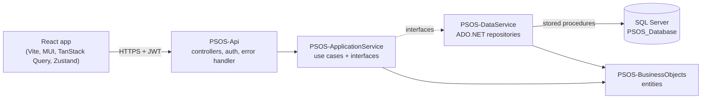
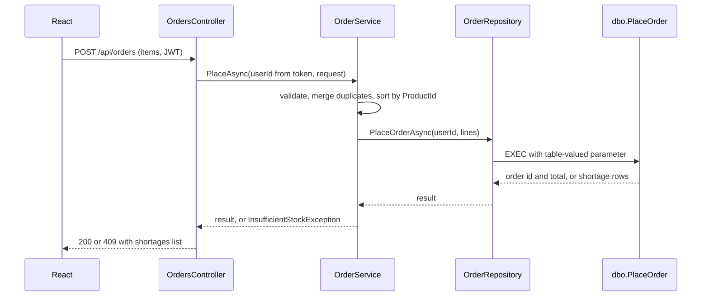

# PSOS: Product Stock & Order System

A small shop system. Customers view products and place orders. Administrators view all orders and low-stock products.


| Part | Technology |
|---|---|
| Database | MS SQL Server (SQLEXPRESS), stored procedures |
| Backend | .NET 10 Web API, ADO.NET, JWT |
| Frontend | React 19 + TypeScript + Vite, Material UI, TanStack Query, Zustand, Axios |

---

## 1. How to run

### Prerequisites
- .NET 10 SDK, Node.js 20+, SQL Server (SQLEXPRESS), SSMS


### Step 1: Database
1. Create a database named `PSOS_Database`.
2. Run the table scripts and insert scripts attached with the submitted email, then `Stored_Procedures.sql` 
3. Insert the sample products using the insert script.

### Step 2: Backend
Edit `PSOS-Api/appsettings.Development.json`:
- `ConnectionStrings:PsosDb`: your server. Default: `Server=LAPTOP-JUDNRV1H\SQLEXPRESS;Database=PSOS_Database;Trusted_Connection=True;TrustServerCertificate=True;`
- `Jwt:Key`: a random secret of 32+ characters.

```
API: `https://localhost:7156`, Swagger: `https://localhost:7156/swagger`

### Step 3: Frontend
```powershell
cd psos-frontend
npm install
npm run dev
```
App: `http://localhost:5173` (this origin is allowed by the API's CORS policy). The API URL is set in `psos-frontend/.env` as `VITE_API_URL`.

### Demo accounts (seeded in Development)
| Username | Password | Role |
|---|---|---|
| `customer1@gmail.com` | `Customer1@123` | Customer |
| `customer2@gmail.com` | `Customer2@123` | Customer |
| `customer3@gmail.com` | `Customer3@123` | Customer |
| `customer4@gmail.com` | `Customer4@123` | Customer |
| `admin` | `Admin@123` | Administrator |


### Concurrency test (Stored Procedure)
Add a small delay inside the PlaceOrder stored procedure transaction.

---

## 2. Architecture

### System overview



### Backend: Clean Architecture (4 projects)

| Project | Responsibility | References |
|---|---|---|
| `PSOS-BusinessObjects` | Entities (`User`, `Product`, `Order`, `OrderItem`) and the `Roles` constants. No dependencies. | none |
| `PSOS-ApplicationService` | Business rules and use cases: validation, merging duplicate order lines, mapping a stock shortage to an exception. It also **defines** the interfaces (`IProductRepository`, `IPasswordHasher`, `ITokenService`, ...) and the DTOs. | BusinessObjects |
| `PSOS-DataService` | Infrastructure. Implements the interfaces with plain ADO.NET, one stored procedure per operation |
| `PSOS-Api` | HTTP layer: controllers, JWT authentication and authorization, Swagger, exception-to-HTTP mapping. It is the composition root, where all dependency injection is registered in `Program.cs`. | ApplicationService, DataService |


### Request flow (placing an order)



### Database

Tables: `Users`, `Products`, `Orders`, `OrderItems`. All data access goes through stored procedures:

| Procedure | Purpose |
|---|---|
| `GetUserByUsername` | Login lookup |
| `GetProducts` / `GetLowStockProducts` | Product list and low-stock list (threshold 5) |
| `GetOrders` | One user's orders, or all orders when `@UserId` is NULL |
| `PlaceOrder` | Atomic stock check and update (see below) |

### How overselling is prevented

A check-then-update in application code is unsafe, because two requests can both read stock = 1 before either writes. So the check and the update happen inside **one stored procedure and one transaction**:

1. The order lines arrive as a **table-valued parameter** (`dbo.OrderItemType`), so the whole order is handled in one call.
2. `BEGIN TRAN`, then the product rows are read with `WITH (UPDLOCK, HOLDLOCK, ROWLOCK)`. These locks are held until commit, so a concurrent order for the same product **waits**, and then reads the already-reduced stock.
3. If **any** line is short, the procedure rolls back, returns the short products and changes nothing (all-or-nothing). The API turns this into **409 Conflict** with a `shortages` list.
4. Otherwise it inserts the order and items, subtracts stock and commits. The **total is calculated in SQL** from the locked prices, never taken from the client.
5. Extras: `SET XACT_ABORT ON` rolls everything back on any error, order lines are sorted by `ProductId` so two orders lock rows in the same order (this lowers the deadlock risk), and `CHECK (StockQuantity >= 0)` on the table is a last line of defense.

### Security

- **Passwords** are stored as BCrypt hashes. The same error is returned for an unknown user and a wrong password, so usernames can't be discovered.
- **JWT** (HS256, 60 minutes) carries the user id, name and role.
- **Authorization is enforced on the server** with `[Authorize(Roles = ...)]`. Only Customers place orders, and only Administrators see all orders and the low-stock list. Hiding links in React is only for convenience.
- **The user id comes from the token**, never from the request, so a customer can't place or read orders as someone else.
- **Errors**: a central exception handler returns `ProblemDetails`. A 500 never exposes the exception message.

### Frontend

```
src/
├── api/          axios client, typed endpoint functions, ApiError normalizer
├── auth/          session helper, RequireAuth route guard
├── stores/       Zustand cart store and auth store
├── hooks/        TanStack Query hooks (useProducts, usePlaceOrder, ...)
├── components/   AppLayout, ProductCard, OrderSummary, StockErrorAlert, PageState, ...
├── pages/        Login, Products, Orders, Admin
└── utils/        formatting and stock-status helpers
```

- **Server state** (products, orders) lives in TanStack Query. **Client state** (session, cart) lives in Zustand. API data is never copied into Zustand.
- Every page handles loading, error (with a Retry button) and empty states through one shared `PageState` component.
- A 409 shows a warning that names each short product with the requested and available quantities. The cart is kept so the user can adjust it, and the product list is refreshed.
- A 401 from the API clears the session, and the route guard redirects to login.

---

## 3. Tools and why they were chosen

### Backend and database
| Tool | Why |
|---|---|
| **.NET 10 Web API** | Required stack. Controllers with attributes give clear role-based authorization and Swagger support. |
| **ADO.NET (`Microsoft.Data.SqlClient`)** | Every operation is a stored procedure. ADO.NET gives direct control of the table-valued parameter and of transaction behavior, with no hidden queries. |
| **JWT Bearer (`Microsoft.AspNetCore.Authentication.JwtBearer`)** | A stateless token the SPA sends in a header. The brief asks for "a basic login that returns a token". |
| **BCrypt.Net-Next** | A slow, salted password hash. Plain or fast hashes such as SHA-256 are unsafe for passwords. |
| **Swashbuckle (Swagger)** | Lets the API be tested with a Bearer token without any frontend, which is also useful for the demo. |


### Frontend
| Tool | Why |
|---|---|
| **React + TypeScript + Vite** | Required stack. TypeScript types mirror the API contract, which catches mismatches at build time. Vite gives a fast dev server and build. |
| **Material UI** | Ready-made accessible and responsive components (grid, cards, tabs, alerts), so time goes into behavior, not styling. |
| **TanStack Query** | Handles caching, loading and error states and refetching for server data. After an order, invalidating the products and orders keys refreshes the UI without manual effect code. |
| **Zustand** | Small store for client-only state (session and cart), with no provider tree. The axios interceptor can read it outside React. |
| **Axios** | Interceptors attach the token and normalize every error into one `ApiError` type, so the UI reads `status`, `message` and `shortages` in a single way. |


---

## 4. API summary

| Method | Route | Role | Result |
|---|---|---|---|
| POST | `/api/auth/login` | public | token, username, role |
| GET | `/api/products` | any signed-in user | product list |
| GET | `/api/products/low-stock` | Administrator | products at or below 5 |
| POST | `/api/orders` | Customer | 200 order id and total, 400 invalid, **409 not enough stock** |
| GET | `/api/orders/my-orders` | any signed-in user | the caller's orders |
| GET | `/api/orders` | Administrator | all orders |

---


